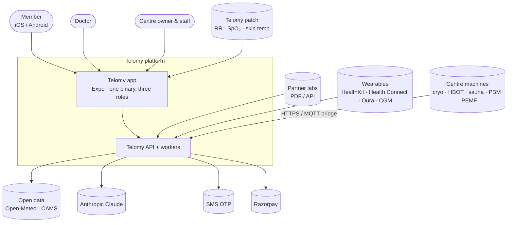
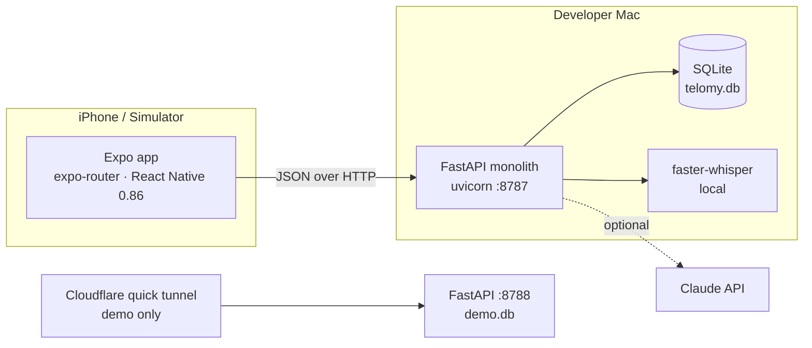
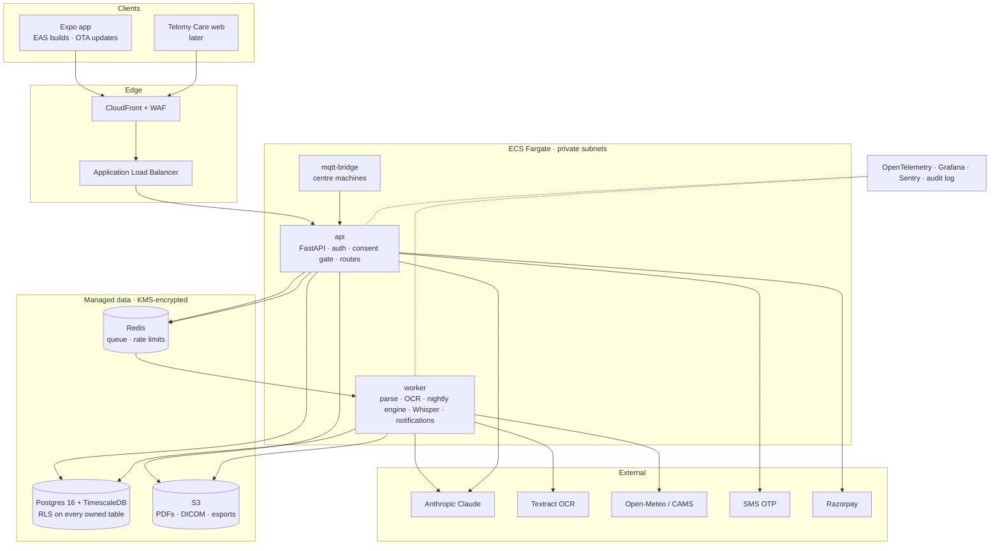
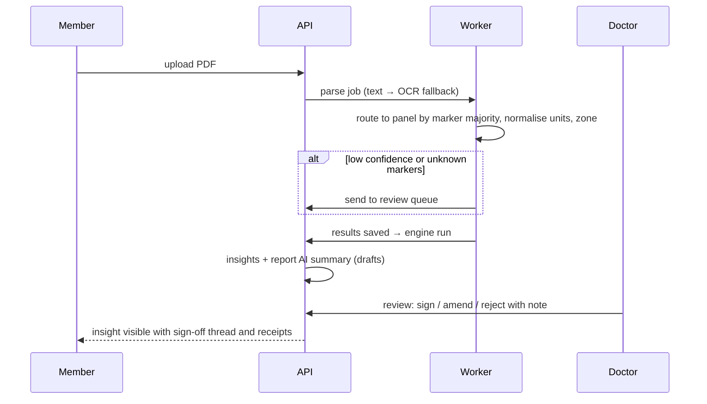

# Telomy: High-Level Design

**Version:** 1.0 · **Last reviewed:** 2026-10-11 · Companion docs: [LLD](LLD.md) · [PRD](../product/PRD.md) ·
[Production plan](../production/PRODUCTION_PLAN.md) · current-state overview in [ARCHITECTURE](../ARCHITECTURE.md)

Diagrams are Mermaid; GitHub renders them inline.

---

## 1. System context



## 2. Current architecture (v0.4 prototype)



One process, one SQLite file, one member Vault, no authentication. See the audit in the production plan §1.

## 3. Target architecture (v1.0, AWS ap-south-1 Mumbai)



**Decisions**

| # | Decision | Rationale |
|---|---|---|
| D1 | Modular monolith + worker, not eight microservices on day one | Team of 3–5; module boundaries already clean; split later along the Engineering Guide v3 service lines |
| D2 | Postgres + TimescaleDB | Relational care data and time-series signals/telemetry in one engine; RLS for tenancy |
| D3 | AWS Mumbai, backups to Hyderabad | DPDP residency; Engineering Guide v3 default |
| D4 | One mobile binary, three roles | Prototype proved it; role comes from memberships after sign-in |
| D5 | Deterministic safety outside the LLM | Contraindications, interactions and alarms are rules with tests |
| D6 | Claude only on PHI-minimised, grounded context | Grounded composer remains the fallback and the test oracle |

## 4. Domains and responsibilities

| Domain | Modules (`backend/app`) | Owns |
|---|---|---|
| Identity & consent | *new* `auth`, `consents` in `main.py` | Users, orgs, memberships, care relationships, consent per purpose, audit |
| Vault | `db`, `labparse`, `catalog*`, `features`, `food` | Markers, signals, events, reports, imaging, meds, documents |
| Engine | `engine`, `derived`, `predict`, `evidence` | Ages, scores, effects, correlations, rules, risk models, insights, N-of-1 |
| Sinc | `sinc`, `summaries`, `voice`, `brief` | Chat, AI summaries, voice intents, specialist packs |
| Therapy | `therapy`, `physio`, `devices` | Modalities, sessions, telemetry, verdicts, plans, floor, phenotypes, HSAI |
| Twin & life | `twin`, `routine`, `activities`, `exposome` | Digital twin, routines, custom activities, environment |
| Care & commerce | `roles`, `plans`, `rx`, `diagnostics` | Panels, queues, monthly reports, consults, Rx, tests, subscriptions |

## 5. Key flows

### 5.1 Sign-in and scoped access (target)

```mermaid
sequenceDiagram
  participant App
  participant API
  participant SMS
  participant DB as Postgres (RLS)
  App->>API: POST /auth/otp/send {phone}
  API->>SMS: send code
  App->>API: POST /auth/otp/verify {phone, code}
  API->>DB: upsert user, load memberships
  API-->>App: access JWT (30 min) + refresh (30 d) + roles
  App->>API: GET /doctor/patients (Authorization, x-purpose: clinician)
  API->>API: check role + care_relationship + consent(clinician)
  API->>DB: SET app.user_id; SELECT … (RLS filters)
  API-->>App: only linked, consenting members
```

### 5.2 Lab report to signed insight



### 5.3 Therapy session in a centre

```mermaid
sequenceDiagram
  participant C as Centre staff
  participant MC as Machine
  participant P as Telomy patch
  participant API
  C->>API: start session (member, modality, params) → safety screen
  MC->>API: POST /devices/{id}/telemetry (X-Device-Key): temp, pressure…
  P->>API: POST /therapy/sessions/{id}/samples: RR, SpO₂, skin temp
  API->>API: channel limits → alarms; RMSSD from RR
  C->>API: finish session
  API->>API: analytics (HR surge, HRV rebound, k, rewarming) + delivered vs prescribed
  Note over API: nightly: next-night effects → per-member verdict
```

## 6. Cross-cutting concerns

- **Provenance:** every value stores source, timestamp, method and confidence; simulated values are flagged.
- **Clinician in the loop:** insights, report summaries, monthly reports, therapy plans and Rx are drafts until signed.
- **Consent:** per purpose (`self`, `clinician`, `centre`, `research`, `marketing`), enforced on every request in v1.0.
- **Auditability:** every read of another person's data is logged with principal, purpose and reason.
- **Time:** stored in UTC; displayed in the member's timezone; the pinned demo clock exists only in local/ci.
- **Reproducibility:** catalogue and model versions stamped on results and insights.

## 7. Environments

| Env | Data | Notes |
|---|---|---|
| local | fixture world (`seed.py`) | `TELOMY_TODAY` allowed |
| ci | ephemeral fixture world | 117+ tests, tsc |
| dev | fixtures + staff accounts | auto-deploy on merge |
| staging | fixtures + consented anonymised subset | mirrors prod |
| prod | real users, DPDP-controlled | no seed, no dev routes |
